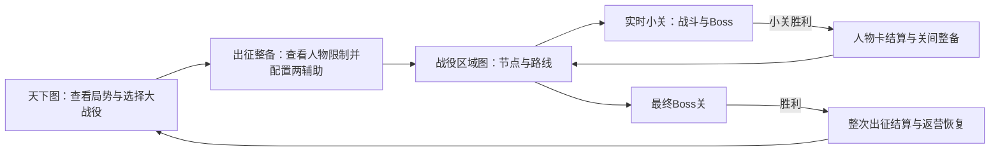
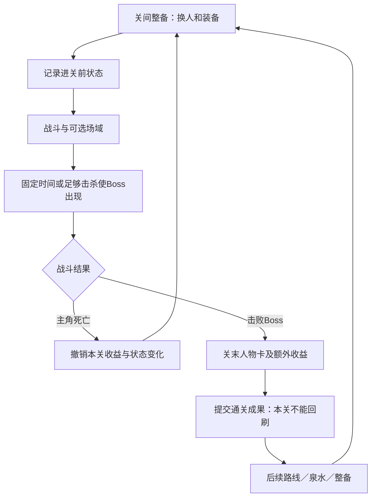

# 主线战役与路线

状态：两层地图、有限主线行动、无限随行、关间自由换两辅助与返营恢复已定。世界为三国覆亡后的遗迹鬼怪世界；前两关及夺寨段四个战斗节点、泉水和主线服务已接入并验证。其余节点及世界状态仍待细化。依据[当前设计共识](00_当前设计共识.md)。

## 夺寨段路线

S03 鬼市落脚 → **B04 运粮道或 B05 冥市暗巷** → B03 匪寨夺旗 → S04 第一批追随者 → F01 寨后古井 → **可选 B06 荒祠兵冢，或直接前往 S05 寨中一夜** → B07 官署外街（未制作）。两条前路互斥，战后在B03汇合；F01按既定泉水规则为已获得人物恢复生命和魔法并复活阵亡者。

S03解锁女医者、军需小吏入池，S04解锁女匪首入池，B06胜利后解锁荒祠咒师入池；入池不等于直接获得。艾玛仍是首关剧情直接入队、不占选卡名额的例外。可玩范围共六个战斗节点，但B04／B05互斥，单次路线通过四场或包含B06时五场。实际结果与验证见[实施记录](implementation/2026-10-27_夺寨聚众四关接入.md)。

## 推进方式

主线参考《兰斯10》中大战役、关卡和路线的组织方式。人物获取、长期培养、持有加成和装备积累贯穿推进过程；每个小关都提供人物卡，大关的卡可以更好或更重要。

女性角色相关氛围已被确定为约占整体体验一半的重要方向，风格直接参考《兰斯》的欲望表达、胡闹和成人冒险。人物事件与征战共同安排，位置与长度根据实际剧情确定；此前渐进恋爱流程的建议撤回，不要求每个角色走同一套关系阶段。具体内容见[世界与人物事件](16_世界背景与风格.md)。

长期体量目标以其第一部为参照，分阶段开发。用户已明确白门楼自成完整大章，主要参考原作节奏，开篇承担入门作用。当前具体讨论见[白门楼完整首章与分阶段开发](design-reviews/2026-10-26_首段教程战役与分阶段开发.md)；女性人物方向已认可，卡牌进一步扩充名将与N卡，原36张目录新增艾玛后暂计37张，详见[卡池草案](design-reviews/2026-10-26_白门楼人物卡池与剧情解锁.md)。36路线节点与单次12—15战仍为试排，首个可玩交付只是完整章节的一部分。

当前进度中已通过的关卡不能返回刷收益，未通过可重试。允许像《兰斯10》一样手动保存并读回旧档；读档恢复整份当时主线状态，后续人物、等级、装备和战果一并回退，不与后来进度合并。具体周目继承机制另定。

## 两层地图

| 层次 | 展示范围 | 玩家用途 |
| --- | --- | --- |
| 天下图 | 包含全部州或较大的地理模块，展示宏观地域与天下局势。 | 点击区域查看信息，了解各地战事和势力，选择参加的大战役。 |
| 战役区域图 | 本次出征涉及的一大片具体区域，以地理背景承载路线。 | 沿普通关、精英关、恢复及事件等节点前进，在分岔作取舍，最终到达战役Boss。 |

从天下图选择大战役后直接进入相应战役区域图，不再插入一个独立的州级地图选择层。州内可以有多场战役，战役也可以跨越州界；区域图的范围由战役需要决定。

区域图体现地点及通路关系，参考《兰斯10》的路线推进。具体路线可结合道路、河流、城池、渡口与关隘安排；本轮夺寨段以外的关卡坐标、分支和可见范围仍待细化。点击战斗节点进入实时战场，结束后回到区域图继续，不把实际战场算作第三层战略地图。

## 小关之间

每关战斗组合为主角与至多两名辅助，允许空位。新游戏开局只有贾苇索，首关战后艾玛直接加入，同时正常五选二；她在首关进场前尚未拥有。小关之间可以换人换装备，生命、魔法和阵亡状态延续。泉水可以全员回复和复活；没有泉水时不自动全员恢复。

随行人数无限，关间可从全部已获得、存活且符合战役条件的人物中换两辅助，新人物从下一关起可配置。后期战役可禁止特定人物进入；具体限制另定。未配置人物仍有持有收益，但不提供本关后台支援。

## 成功与失败的边界

图示只表达玩家流程，不规定存档的原子提交步骤。失败恢复进关前快照，此前成功关卡的成果不丢失。辅助本关阵亡后若过关，则阵亡延续到泉水或整次出征结束返营后复活；若本关失败，该次阵亡随本关状态一起撤销。

“完全过关”指整次出征返营并全员恢复。战斗中退出后从本关进场前恢复，此前通关成果保留；已成功但未结算完的奖励恢复至原候选继续选择。手动读旧档按整份存档回退，主动放弃出征的后果另定。

## 三国背景下的主线组织

以下是已认可的框架；当前采用[三国覆亡后的架空世界](16_世界背景与风格.md)，具体世界成因、州域划分、主角身份和势力关系尚未定。地图来源见[州城地图调研](design-reviews/2026-10-26_三国背景与州城地图数据调研.md)，资料中的城市数量不直接成为本项目关卡数量。历史地理可作为遗迹与区域的空间参考，不能直接把历史政权状态当作当前局势。

《兰斯10》的[官方系统介绍](https://www.alicesoft.com/rance10/system/index.html)说明，主线轮次包含准备、作战、据点与战况报告，任务地图把移动、战斗、奖励和分支简化为节点；行动成果影响地区战况。本项目借鉴其“选择战事—执行任务—人物成长—局势变化”的联系，出征、恢复与实时小关按本项目规则组织。

### 地理与流程的关系

| 对象 | 在本项目中承担的作用 | 举例或边界 |
| --- | --- | --- |
| 天下图与州域 | 呈现地区、势力和正在发生的战事，承载可选出征入口。 | 一州可同时存在多个战役，一场战役也可跨州；不规定十三州就是十三章。 |
| 城池、关隘、渡口 | 给战役提供地点与通路；是否开放由局势和路线决定。 | 一个城池可在不同阶段发生不同事件；已完成的那个关卡仍不可回刷。 |
| 主线阶段 | 界定当前局势、可参加的战事及阶段结束条件。 | 由覆亡后的势力和地区变化组织；历史事件可作遗迹来源，不默认按史实时间重演。 |
| 一次出征 | 选择战役并经历连续小关，再回到天下图。 | 白门楼按完整章节试排；不同战役长度可以不同，不沿用旧4—6关默认范围。 |
| 战役区域图与内部路线 | 展示具体区域，组织普通小关、精英关、恢复/事件节点和战役终战，形成连续消耗与局部战果。 | 某条路开放泉水，另一条路削弱后续敌军；路线选择在关间发生。 |
| 小关 | 一场完整的实时战斗，也是保存本次成功成果的单位。 | 自动攻击、两辅助、四角场域、Boss通关、关末抽卡均沿用已定规则。 |

当前口头“大关”明确为“大战役”，其中最后一场仍称“小关”或“战役终战”。空间层级与玩法层级不必一一嵌套。

### 主线如何推进

采用“查看天下局势 → 选择一次出征 → 返营整备与人物事件 → 结算局势”的循环。支援任务和大战役都属于一次出征，各占一次主线行动，不另外强制每轮先做一遍支援。短任务用明确的战果、人物机会或路线变化体现价值，而不只比抽卡次数。

同一主线阶段有有限的出征机会，未处理战事在阶段末形成相应结果。“三条战事只能完成其中两条”只是示例，具体数量、期限及各分支后续尚未确定。选择前交代行动消耗、明确期限及可知后果，不标注推荐培养或最优路线。

主线行动在完成一次出征并返回时结算。小关失败重试不推进天下局势，不额外消耗行动；战斗内提前召出Boss与限时经验只影响本关，不用来计量天下时间。主动放弃出征和中途换任务仍未定，不能直接沿用参考游戏的撤退推进规则。

一个州可出现更多新事件，但同一成功节点不能靠出入地图重新领取奖励。剧情使用同一个地名时，应是新的战事及其后果，不是恢复已通关任务。

### 首场大战役：白门楼鬼城

用户已确定主线：贾苇索听闻白门楼鬼城有绝色女公主吕玲绮而出征，从去白门楼途中遭遇魔法师艾玛开始，杀匪杀官、掠地壮大；过程中从鬼曹军手中救城，并间接救了吕布一家；最后对战吕布，踏上诸侯起家之路。具体编排见[首战草案](design-reviews/2026-10-26_首段教程战役与分阶段开发.md)。

新增已定剧情：贾苇索在抵御鬼曹军前劫掠并侵犯成年吕玲绮，过程略去。建议先按“入城冲突—杀匪夺寨—杀官掠地—吕玲绮受害—抵御鬼曹军—吕布终战”组织剧情，再划分小关、事件、分岔和泉水；侵犯事件在城中行动的具体位置未定。剧情段落不等于战斗小关。

救城之恩与伤女之仇同时存在，侵犯成为吕布终战的核心冲突。吕布怎样回应救城、吕玲绮本人怎样反应及行动，都需具体编写；不预设两人因此原谅或归顺。吕布战后是否存续、吕玲绮是否加入和主角取得哪些领地仍未确认。

每个战斗小关有Boss、四角场域和正常结算，独立精英关与场域精英分别设计。普通五选二、抽卡精英成功五选三；章末七选三且至少两张重要候选，同类精英成功七选四。剧情先解锁人物，再参与候选与保底；泉水和剧情节点不自动发一份小关奖励。

小关四角场域负责眼前补给、经验或挑战选择；战役分岔负责后续恢复、敌军状态和收益；天下图负责这一阶段投入哪场战事。白门楼起家的叙事成果可落实为首处据点、班底和势力地位，具体归属待定，不自动增加内政建设系统。

### 队伍、恢复与保存

出征不预选有限名单，也不再设计容量扩充或满员替换。每关仅配置主角和至多两辅助，其他人物作为候补；其生命、魔法和阵亡状态继续保留，换下再换上不重置。特殊战役的人物禁入条件在出征前说明。

“完全过关”指完成一次出征并返回营地，在这里全员恢复和复活。大战役内部仍要依靠泉水或角色能力，普通关间整备不自动回复。恢复节点在三国背景中可以表现为医帐或补给营，具体美术称谓另定。

胜利小关立即保留人物经验、卡牌、装备及成功路线战果。下一小关失败只回到该关之前；例如第二关有辅助阵亡并成功通关，第三关失败不能把该辅助的阵亡一并撤销。只有第三关本次尝试的变化会回退。辅助在泉水或出征完成后复活。

当前路线不能回刷成功小关，失败不整体重开战役。换人不刷新生命、魔法和阵亡；战斗中退出回到本关进场前，关间或待结算处退出恢复该进度。手动读旧档可以重走其后的发展，但整份养成和战果同步回退。

人物卡与战役内容建立联系：先完成对应剧情取得入池资格，再从符合资格的人物中抽取；基础人物与当地战事人物共同形成候选范围。人物可在后续战役继续登场和培养，建议已解锁人物保留后续抽取机会并按战役调整权重。具体组成、概率和重要人物奖励形式未定。重复卡升级、战斗经验、等级解锁技能与持有被动继续遵循现有共识。

### 仍需结合具体内容确定

原作体量另见[任务、节点与卡池调研](design-reviews/2026-10-26_兰斯10任务节点与卡池体量调研.md)。原作路线格数、手动战斗次数与本作实时小关数量分别计量；当前关数依据完整白门楼草案讨论，不再沿用旧4—6关入门试排。

两层地图、一次大战役对应一次出征、有限主线行动、无限随行与返营恢复已定。后续仍需明确具体人物禁入条件、后续泉水布局与角色技能、终战后领地和主动放弃后果。
