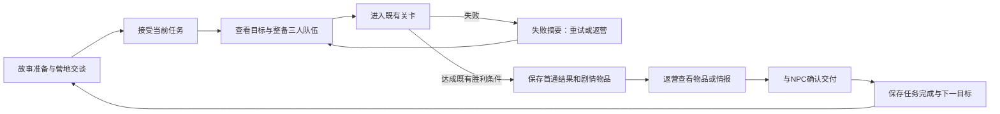
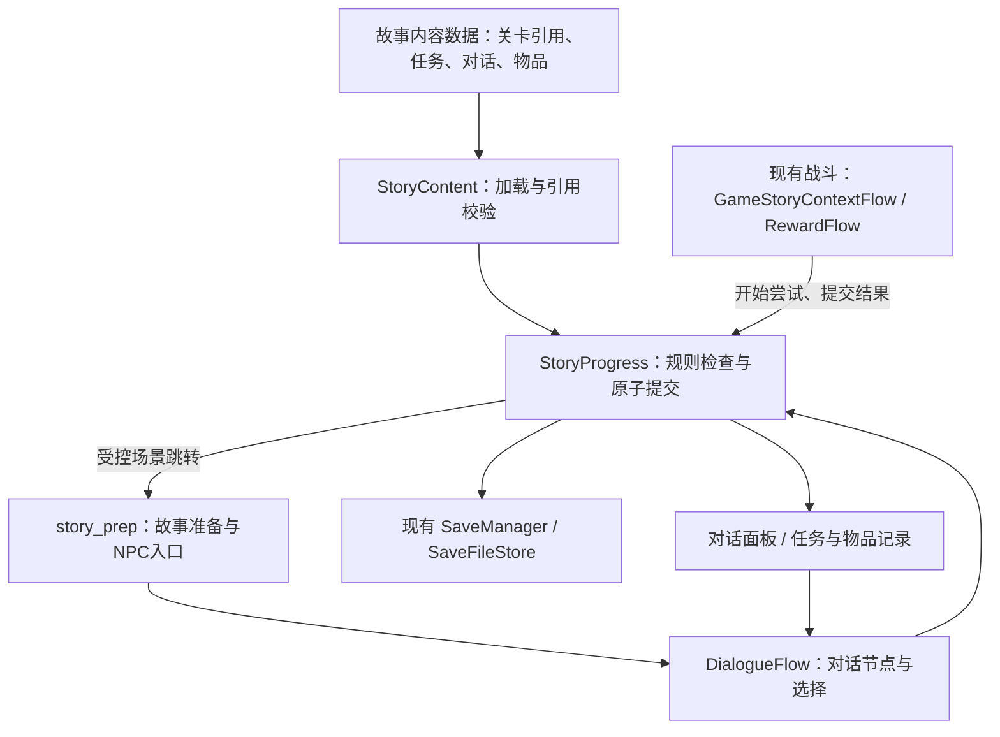

# 对话、道具、主线与剧情推进架构

> 设计基准：`9c1472e`，2026-10-23。用户已确定本轮以当前版本为主，重点补全游戏系统框架；人物技能与怪物机制保持现状。剧情先沿用“前哨清剿 → 裂隙推进 → 星核讨伐”，允许后续替换。
>
> **本文为已采用的实现合同，首章已接入运行，`STORY_MODE_ENABLED=true`。** 剧情措辞与“恢复通讯”的动机仍是可替换草案。实际文件、已通过验证与未完成发布条件见[实施记录](implementation/2026-10-23_系统框架实施.md)；[原评审](design-reviews/2026-10-23_当前版本整体完善评审.md)保留实装前证据。

## 1. 完成边界与现有基础

第一阶段的完成边界是一章三关的完整闭环：玩家知道为何出击，完成关卡后获得明确的物品或情报，返回与NPC交付，看到世界状态和下一目标发生变化；退出、失败、重试、重复交互和回刷均有确定结果。

| 系统 | 实装前基线（9c1472e） | 本轮采用的补齐方向 |
| --- | --- | --- |
| 故事入口 | 主菜单、故事选档、准备页均有关闭门禁 | 验收后的开放条件，避免只开菜单即视为完成 |
| 关卡 | 三关已有稳定ID、180/210秒普通关、135秒出Boss的第三关 | 接取、首通、交付、下关解锁与已通关重访 |
| 队伍 | 四角色可用、三人出战、故事准备页可整备 | 对话说话者与出战队伍分离，不因某角色不在队伍而卡剧情 |
| 营地交互 | 距离检测、最近交互点、F键、面板移动锁、商店与角色介绍 | 有进度条件的NPC对话、当前目标、剧情道具与记录 |
| 道具 | 无尽携带17种、局内角色装备、掉落物、故事Boss核心计数 | 道具生命周期、剧情物品、固定交付与情报记录 |
| 剧情状态 | `current_stage_index` 加一；没有任务或对话状态 | 显式任务状态、对话断点、首通记录、领取凭据 |
| 保存 | JSON临时文件替换、运行档与备份、模式/槽位目录 | 故事档版本迁移、语义验证、失败恢复与跨文件提交顺序 |

上表左列为设计起点，当前行为见第2—10节与实施记录。

## 2. 玩家实际经历的循环



战斗完成和剧情交付是两个事件。完成关卡先获得物品、保存事实；NPC交付再推进主线。领取与交付均不得只依靠一个瞬时弹窗。玩家关掉界面后，应能从任务日志和NPC再次进入。

## 3. 模式、成长和状态边界

1. **故事与无尽存档继续隔离。** 保留 `story_slots/slot_x` 与 `endless_slots/slot_x`。故事道具不写入无尽携带列表，剧情也不修改N解锁、骨头和无尽阵容。
2. **故事战斗先沿用现有三关节奏。** `CombatWaveFlow.enabled()` 当前排除故事模式；本轮不把无尽20波、波末免费祝福直接复制给每个故事关卡，也不修改人物技能或怪物参数。
3. **局内成长先沿用每关重开的边界。** 继续同一战局恢复本关等级、技能点、装备和构筑；新开下一关或重试从本关初始状态开始。剧情进度、关键物品和已知情报永久保留。短关能否提供足够的加点体验需要实战验证，不能凭无尽等级预算推算。
4. **四角色不重新上锁。** 既有故事档已经拥有四人；剧情介绍不等于重新授予角色，不借本轮迁移清空角色或阵容。
5. **主线只有一个当前必做任务。** 可选谈话和情报阅读不阻止出击；必做交付有明确标识。第一章不增加支线任务板、好感数值、日常刷新或新货币。
6. **失败保留叙事状态。** 已接受任务、之前关卡首通、已提交道具不回退；当前未结算战局仍按运行档规则处理。需要主动放弃战局时明确提示将清除本关构筑。

## 4. 对话系统

### 4.1 NPC交互入口

NPC交互菜单由当前故事状态派生，优先级固定为：可交付主线 → 可接受主线 → 当前任务提醒 → 未读可选谈话 → 常驻功能。打开功能菜单不必重复播放已读剧情。标记含文字或形状，不能只靠颜色。

| NPC/角色 | 框架职责 | 第一章内容用途（可替换） |
| --- | --- | --- |
| 剑士 | 出发动机、行动确认、队伍视角 | 说明前哨失联带来的现实压力 |
| 枪手 | 观察、信息交接 | 接取并交付前哨记录 |
| 法师 | 解释已有证据，补充可选信息 | 解释裂隙样本，不凭空给玩家尚未获得的结论 |
| 机械师 | 道具检验、阶段成果反馈 | 接收样本并确认星核位置 |
| 铁匠 | 明确材料用途和交付结果 | 接收核心、恢复通讯装置 |
| 阮狗 | 旅行见闻与服务入口 | 可选线索、道具用途提醒；无尽模式的现有商店保持原规则 |

剧情对话按NPC身份播放，不要求NPC恰好在出战三人队伍中。第一版使用现有名字与头像/像素形象，不要求新立绘、配音或新增角色。

### 4.2 对话节点与输入

节点支持正文、说话者、下一节点或选择。选择只分为“了解更多”“接受/交付”“稍后”；可选信息分支汇回同一主线。没有会在未提示时锁死主线的选项。

- 确认键先显示完整当前句，再推进；鼠标和键盘均能选选项。
- 输入读取现有键位设置；对话打开时停止角色移动并截获交互键。关闭后恢复原焦点，不能让同一次F触发身后交互点。
- Esc关闭可选谈话；必做谈话允许稍后继续，任务保持原状态。开关面板本身不完成任务。
- “跳过”仅跳过当前已允许的叙述段，停在下一次需要玩家选择/确认处；不能替玩家接受任务、消耗物品或领取一次性奖励。
- 可查看当前谈话记录；存档用 `dialogue_seen_nodes` 记录实际看过的节点ID。重看只展示这些节点，不执行任务命令，也不提前展示未走过的剧情。可选谈话是否已读从已见终止节点派生。
- 对话存在于安全的故事准备/营地阶段；战斗中如需台词，只显示不夺取操作的提示，不在本轮加入战斗中强制对话。

### 4.3 中断和恢复

持久化 `conversation_id + node_id`，只在进入稳定节点、作出选择、主动关闭时保存。失败的保存不能显示“已接受/已交付”。纯逐字播放进度不入档，重开时从该句起点显示即可。

“交付”选择必须把道具扣除、任务完成、下一段解锁和对话下一节点作为同一次故事档提交。提交失败留在原选项，可重试；不存在“道具没了但剧情没进”的半完成状态。

对话入口条件只控制新开谈话。恢复已提交的接受/交付后节点时，要校验断点与对应凭据；不能因为任务状态已经改变，就把成功后的台词判成不可达。旧选项再次触发时仍需重查当前任务状态，不能凭断点跳过检查。

## 5. 主线任务与关卡状态

任务仅有 `locked / available / active / ready_to_turn_in / completed` 五种持久状态。准备页是否可出击、NPC标记、下一目标文案均从这些状态和已通关记录派生，不各存一套解锁布尔值。

| 转移 | 前置条件 | 写入结果 | 不能发生的副作用 |
| --- | --- | --- | --- |
| locked → available | 前置任务已完成 | 当前任务可接受 | 不自动替玩家接受 |
| available → active | 玩家确认接受 | 保存接受状态、对话断点 | 不扣道具或发战斗奖励 |
| active → ready_to_turn_in | 对应关卡正式首通并提交结果 | 保存通关事实、固定剧情物品、待交付状态 | 不提前解锁下一关 |
| ready_to_turn_in → completed | 交付人、物品及前置均满足 | 原子扣除物品、记录情报、完成任务、开放下一个任务 | 不清除其他剧情物品 |
| 任意状态重复同一已提交命令 | 领取凭据存在 | 返回已处理结果 | 不再次扣除或发放 |

关卡使用已有稳定ID，不用数组下标作为存档中的长期身份。每次出击有 `attempt_id`、`stage_id`、`purpose=advance/replay`，并带模式和槽位。`current_stage_index` 仅留作旧接口的兼容派生值。

**回刷：** 已通关关卡可重访，进入前明确“练习回刷；不会推进主线或重复获得剧情材料”。本轮保留局内正常成长，返营清除此局构筑；不设计额外永久刷取经济。回刷不能替代尚待交付任务，不能把主线索引再加一。中断回刷保存并恢复其 `purpose`。

**出击与放弃：** `begin_stage` 先写故事档中 `phase=starting` 的活动尝试，再建立同一身份的初始运行档，最后将尝试确认成running后进入战斗。中途写盘失败保留待恢复状态；重试沿用同一ID，不能生成多个战局。读取时，starting且没有运行档可重新建立本关初始快照；starting且存在同ID有效运行档可确认后继续。running却找不到有效主/备运行档属于损坏，不自动伪装成新开局；出现身份冲突也保留文件并进入恢复入口。失败或主动放弃通过 `end_attempt` 清除此尝试的可继续资格，保留任务与已交付状态；档案提交成功后再清运行档。重试创建新尝试，旧运行档不得覆盖它。

## 6. 道具体系与生命周期

### 6.1 先确定每类物品属于哪里

| 类型 | 当前权威 | 获得/使用 | 持久化和丢失边界 |
| --- | --- | --- | --- |
| 骨头 | 无尽永久档 `bones` | 当前击杀/结算、商店支付/退款 | 永久；不在故事中另造同名余额 |
| 无尽17种携带物 | `ruan_stone_purchased` 与 `ruan_stone_system.gd` | 现有5骨购买、逐份退款、最高解锁N决定容量 | 保留重复份数、进场与继续语义 |
| 局内角色装备 | `role_equipment_levels` 与 `player_equipment_flow.gd` | 现有奖励、角色赠与 | 本关/本层；继续恢复，新关重置 |
| 经验、回复、未拾取骨头 | 当前运行态掉落系统 | 拾取后即时应用 | 保持既有运行档；不变成新背包物品 |
| 剧情关键物品 | 新 `story.quest_items` | 关卡固定首通奖励、指定NPC交付 | 永久直到交付；不占无尽携带容量、不卖、不扔、不赠与 |
| Boss核心材料 | 现有 `boss_core_fragments` | 第一章第三关首通授予，指定任务交付使用 | 保留旧字段与旧余额；不再在另一个物品计数里重复存储 |
| 情报/见闻 | 新 `story.journal_entries` | 读对话或交付后解锁 | 是可重看的记录，不需要背包格数 |

**本轮不把这些现有状态强行合成一个大背包。** 展示可以共用列表和详情控件；写入仍由拥有相应状态的现有模块负责。剧情物品由故事推进模块处理，战斗装备仍由装备模块处理。

### 6.2 第一章最少物品

| ID | 展示名（草案） | 固定来源 | 交付用途 | 最大持有 |
| --- | --- | --- | --- | --- |
| `item.outpost_log` | 前哨记录 | `chapter1_stage1` 首通 | 枪手整理路线，解锁裂隙调查任务 | 1 |
| `item.rift_sample` | 裂隙样本 | `chapter1_stage2` 首通 | 机械师与法师确认目标，解锁星核任务 | 1 |
| `material.boss_core` | Boss核心 | `chapter1_stage3` 首通 | 铁匠修复通讯装置，完成本章 | 映射既有核心计数，不截断旧余额 |

关键剧情物品由胜利结算保证获得，不能用随机掉落控制主线可达性。查看物品不消耗；交付按钮预先显示交付对象、消耗和结果。背包页的“任务物品”显示来源和下一用途，已交付的信息进入记录页。

`item_id`、显示名称、图标、说明、持久范围、数量规则、来源和可执行动作放在定义数据里；数量和归属放在存档里。剧情道具不直接包含角色属性增益，不借本轮修改战斗数值。

## 7. 奖励、交付和保存的一致性

现有营地交易已经采用“加载副本 → 修改 → 写盘成功才发布”。故事命令沿用这一做法，并加入有限的一次性凭据。

### 7.1 通关提交顺序

1. 战斗先保存 `pending_settlement`，包含尝试ID、关卡ID、推进/回刷、完成结果和可重试的结算入口。没有保存成功不能销毁唯一战局快照。
2. 故事推进模块从磁盘读取当前故事档，核验模式、槽位、活动尝试、关卡目标和奖励ID。
3. 在副本里写入首通、任务物品、任务状态、领取凭据和待展示的返营信息。
4. 一次原子写入故事档。失败保留战局和重试入口；成功后才更新界面、标记结算完成并清理本次运行档。
5. 若写故事档成功后进程退出，运行档可能仍在。下次根据已领取凭据只做恢复展示/清理，不重复发奖。

首通凭据使用有限稳定键，例如 `stage:chapter1_stage1:first_clear`；交付使用 `quest:q.c1.outpost:turn_in`。凭据记录来源尝试ID与结果。第一章无需保存无限增长的所有事件日志。回刷不发永久奖励，以活动尝试和最近结算记录处理重复提交。

### 7.2 交付提交顺序

按当前档重新检查任务状态和物品数量，在同一副本内扣物品、加情报、完成任务、开放下个任务、设置对话断点和凭据；一次保存后再发布。按钮双击、旧面板命令和重复载入均走同一入口。

### 7.3 错误恢复

| 边界 | 必须得到的结果 |
| --- | --- |
| 对话中退出 | 回到稳定节点，不重复执行已提交命令 |
| 领奖菜单中退出 | 原奖励/任务仍待领取，不只恢复后续奖励 |
| 故事档写入失败 | 留在可重试状态；运行档和原故事档仍有效 |
| 故事档成功、清运行档失败 | 凭据防重发；下次只清理已结算的旧战局 |
| 主档可解析但字段无效 | 验证备份；不得因主档无效而删掉有效备份 |
| 永久档损坏 | 显示损坏/恢复，不伪装成新空槽；保留原件 |
| 物品不足或命令已过期 | 不扣、不推进，返回可读错误并刷新当前状态 |
| 已领取关键物品异常缺失 | 仅能凭明确首通凭据和未交付状态修复对应关键物品；不能推测并补发货币 |
| 跨槽位/跨模式命令 | 拒绝，不使用当前全局槽位猜测来源 |

永久故事档需要一份经过语义验证的可恢复备份。更新时先保留上一个有效版本，再原子替换主档；损坏主档不能覆盖好备份。现有运行档的“双份同快照”与永久档的“上一个有效版本”职责不同，不能把复制两次视为跨文件事务。选档读取只报告健康/可恢复/损坏状态；真正恢复或新建才写盘，不在列表刷新时归档、删除战局。

## 8. 故事档与迁移

当前故事档采用 `schema_version=2`，内容数据另有 `content_version`。以下为结构示意，不是现有可直接导入存档：

```json
{
  "schema_version": 2,
  "slot_id": 1,
  "mode": "story",
  "team_order": ["swordsman", "gunner", "mage"],
  "unlocked_role_ids": ["swordsman", "gunner", "mage", "mechanic"],
  "boss_core_fragments": 0,
  "story": {
    "content_version": 1,
    "quest_states": {"q.c1.outpost": "active"},
    "completed_stage_ids": [],
    "quest_items": {},
    "flags": {},
    "journal_entries": [],
    "dialogue_checkpoint": {},
    "dialogue_seen_nodes": {},
    "active_attempt": {},
    "claimed_reward_ids": {},
    "last_settlement": {},
    "pending_presentation": []
  }
}
```

字段所有权：任务状态、剧情物品、首通、旗标、情报、凭据及展示队列由 `StoryProgress` 写；对话控制器提出断点更新，由同一提交入口保存；战斗只写运行态和结算请求。当前任务提示、可出击关卡和NPC标记是派生数据，不再保存。

关键字段约束：`active_attempt` 保存attempt_id、stage_id、purpose、starting/running阶段和出击阵容快照；运行档增加同一身份的 `story_attempt`，沿用既有玩家/装备/关卡快照。胜利后运行档中的 `pending_settlement` 再记录该身份与正式胜利结果。故事档 `last_settlement` 保存最近结束尝试的身份、胜利/失败/放弃结果和是否已提交；它不能代替有限首通凭据。任何读取先验证类型、模式、槽位和ID一致性，再决定继续、恢复展示或清理旧run。

`pending_presentation` 只负责“已保存的结果还没有展示”，确认展示不会再次发奖励。只存确有待展示的少量内容ID，完成即移除。

迁移必须同步修改 `save_profile_defaults.gd`；当前 `STORY_PROFILE_COPY_KEYS` 会丢弃新字段，已由隔离探针确认。

迁移规则：

- 先备份并验证旧档，保留槽位、四角色、阵容、核心余额与时间信息。
- 旧 `current_stage_index=n` 表示前n关已经推进；把这些关卡映射为已通关、对应任务已完成，不让玩家重交过去从未存在的道具，也不补发过去已处理的核心。
- 第一章旧档 `n=0/1/2` 开放对应下一个任务；`n=3` 保留本章完成。其他章节或超出0—3的索引进入版本/恢复检查，不推测其含义。旧档迁移不扣核心；新的第三关交付消耗只适用于走新版任务流程的档案。
- 对已完成任务建立迁移凭据，并补齐对应情报与完成旗标，防止重看或回刷补发首通物品；只恢复信息，不重新执行材料授予/消耗。索引越界、模式不符和数据类型错误须进入恢复流程，不能静默清零。
- 若旧运行档存在且身份/关卡可映射，显式建立 `purpose=advance` 的活动尝试，并把对应当前任务设为active后继续；无法确定归属则保留文件并提示，不把它当成任意新关卡。
- 未知内容ID保留为不可用条目并报告版本不匹配；不得直接删除玩家物品。未来版本的整个存档不降级写回。

后续改写台词、标题或图标不换稳定ID；删除/替换任务与节点必须提供显式迁移映射。增加章节不改写已经提交的第一章结果。内容版本升级与存档schema升级分开，不能仅靠一个“版本号变了就重置”的分支处理。

## 9. 模块边界与接入位置



| 文件/模块 | 职责 | 实现边界 |
| --- | --- | --- |
| 新 `scripts/story/story_content.gd` | 读定义、按稳定ID查询、校验引用 | 不保存进度，不执行任意脚本字符串 |
| 新 `scripts/story/story_state.gd` | 类型与版本验证、旧进度迁移、任务状态约束 | 不依赖SaveManager，避免保存层和业务层循环依赖 |
| 新 `scripts/story/story_progress.gd` | 接任务、开局、通关、交付、恢复、迁移协作 | 唯一故事业务写入口；采用现有RefCounted/flow风格，无需新增全局事件总线 |
| 新 `scripts/story/dialogue_flow.gd` | 节点、选项、跳过、断点、只读重看 | 不直接扣道具或推进关卡 |
| 新 `scripts/ui/story/dialogue_panel.gd` | 说话者、正文、选项、焦点与记录 | 复用 `SurvivorsModal`，不持有另一个任务状态 |
| 新 `scripts/ui/story/story_journal_panel.gd` | 当前任务、已知情报、剧情物品的列表/详情 | 首版共用一个面板的页签，不另造背包格子系统 |
| 现有 `story_prep.gd` | 故事中枢、NPC按钮/交互、下一目标、队伍、关卡重访 | 首个可运行切片沿用现有场景，避免等待新营地美术 |
| 现有 `story_data.gd` | 模式开关、角色池和既有关卡参数 | 保留兼容入口；剧情内容逐步移到独立数据，关卡参数不在本轮重做 |
| 现有 `game_story_context_flow.gd` | 把指定故事尝试转换为战斗上下文 | 不再仅从“当前索引”猜测所选回刷关卡 |
| 现有 `reward_flow.gd` | 战斗结束、重试结算及返营展示 | 不再自行加索引、忽略保存结果后离场 |
| 现有 `save_manager.gd`、`save_profile_defaults.gd`、`save_file_store.gd` | 模式/槽位、schema、规范化、主备验证与写盘 | 改动必须保留无尽存档行为并做回归 |

后续如需要可走动的故事营地，复用 `camp_player`、`camp_interactable`、场景美术和共享面板。当前 `endless_camp.gd` 直接读取无尽档，不能直接把故事档传进去；届时只抽出世界布局/公共交互，故事和无尽控制器分别拥有自己的业务。首版不以完成这次场景拆分为前提。

## 10. 对外命令与错误合同

| 命令 | 输入 | 成功结果 | 主要拒绝条件 |
| --- | --- | --- | --- |
| `accept_quest` | 明确的故事槽位、quest_id | 任务active、对话下一节点 | 锁定/未知任务、槽位不符、保存失败 |
| `begin_stage` | stage_id、advance/replay | 持久化attempt_id、固定阵容、进入战斗 | 未接任务、未通关回刷、已有未处理战局 |
| `end_attempt` | attempt_id、失败/放弃原因 | 保存结束原因、解除续战资格 | 尝试不匹配、胜利结果尚待结算、保存失败 |
| `settle_stage` | attempt_id、stage_id、正式胜利结果 | 首通/物品/待交付或回刷摘要 | 尝试不匹配、非胜利、重复/过期结果 |
| `turn_in_quest` | quest_id、交付NPC、对话节点 | 原子消费和推进 | 错误NPC、物品不足、任务未就绪 |
| `checkpoint_dialogue` | conversation_id、node_id | 保存稳定节点 | 未知节点、不可达节点、保存失败 |
| `ack_presentation` | 已提交展示ID | 删除已读展示项 | 未知ID；重复确认只返回已处理 |

返回统一包含 `ok`、稳定 `reason`、提交后的只读视图和待展示结果。UI把 `save_failed / item_missing / invalid_state / stale_attempt / content_mismatch` 转成玩家能理解的提示，不能显示原始字段名。

每个命令都携带明确的 `mode=story` 与槽位上下文；表格只列各自附加参数。数据中的命令只写类型和内容ID，实际NPC、当前断点和槽位由控制器绑定后交给业务入口核验。开发者试玩使用隔离档或只读内容预览，不借正常槽位领取一次性奖励。

内容条件首版仅需“任务状态、关卡已完成、物品数量、已知旗标”，条件列表采用全部满足。对话数据只调用上述已注册命令；物品和关卡ID从目录校验，不允许 `eval`、任意属性赋值或文件路径执行。复杂表达式、可视化任务编辑器和插件式脚本机制不在首版范围。

## 11. 第一章样例与内容替换

实际内容位于 [`assets/story/chapter1.json`](../assets/story/chapter1.json)。[原设计夹具](story/chapter1_framework.example.json)保留为来源；编辑内容后运行 `python3 scripts/tests/check_story_content.py`，再运行剧情专项检查。

| 阶段 | 玩家知道的目标 | 现有关卡 | 返回后的互动 | 持久结果 |
| --- | --- | --- | --- | --- |
| 开场 | 前哨失联，先带回可靠信息 | 不进入战斗 | 剑士简述处境、枪手接受调查 | 第一任务active |
| 前哨清剿 | 完成既有180秒战斗，带回记录 | chapter1_stage1 | 查看前哨记录，向枪手交付 | 情报“前哨报告”，裂隙任务available |
| 裂隙推进 | 完成既有210秒战斗，取得样本 | chapter1_stage2 | 机械师接收样本，法师解释结果 | 情报“裂隙分析”，星核任务available |
| 星核讨伐 | 按现有Boss规则获胜，带回核心 | chapter1_stage3 | 铁匠明确消耗1核心，玩家确认修复 | 本章完成、通讯恢复记录、三关可重访 |
| 本章之后 | 复盘本章与重新挑战已通关关卡 | 已完成关卡 | 可选NPC后话、任务记录 | 无重复主线材料，不强制返回无尽开新档 |

这些任务只使用现有关卡完成事件，不增加怪物类型、敌人行为或技能前置。首版关键道具从结算取得，无需先实现地图拾取任务物。

示例台词控制在每个节点1—3句。接受前解释目标和奖励，交付前解释消费，完成后说明下一步。可选长解释由玩家主动展开；名称和文本换掉后，稳定ID、任务条件与存档仍能工作。

## 12. 界面与操作验收

- 故事准备页同屏回答：当前任务、下一步找谁/去哪、出击阵容、是否存在继续战局。已通关关卡与下一必做关卡明确区分。
- 任务页显示“已接取/待交付/已完成”、当前客观条件和目的地；未解锁任务不提前剧透完整结论。
- 物品页显示“剧情物品，不占无尽携带位”、来源、用途和数量；不可用动作不以可点击按钮伪装。
- 对话面板使用当前中文阅读字体，1280×720和960×540检查长文本滚动、选项与关闭按钮；重要动作有文字，键盘焦点可见。
- 新手只在第一次需要时说明技能点、任务交付、继续战局和回刷边界；复用现有教学与当前绑定，不强制重播整套训练。
- 当前人物页已有四页和14项总览属性，不以旧文档的11项说明重建界面。技能点细黄边/隐藏数量的现有方向保留，只修正语义和首次说明。

## 13. 内容制作与结构检查

内容文件需通过：唯一ID、说话者存在、下一节点存在、选项有去向、入口能到结束、无无法退出循环、任务前置无环、关卡ID存在、物品有合法存储归属、消耗非负且来源可达、一次性奖励有稳定凭据、所有必做任务都可完成。

数据校验不等于正式运行验证。还需在真实故事入口完成一次“接受→保存退出→继续→胜利→结算失败重试→返营交付→解锁”，再跑回刷、读旧档和重复点击。

## 14. 分期交付与完成标准

| 阶段 | 连贯交付物 | 通过后才进入下一阶段 |
| --- | --- | --- |
| A 保存与状态底座 | 修复已复现的数据恢复/奖励断点；故事schema与迁移；定义/命令校验 | 故障注入不丢有效备份、不丢待领奖、重复结算不重复发奖 |
| B 第一条纵向流程 | 准备页NPC→接第一任务→第一关→道具→交付→下一任务 | 真实入口、所有中断点、键鼠操作都成立；技能/怪物无改动 |
| C 第一章完整 | 三任务、六NPC的必要对话、两剧情道具与核心、日志、关卡重访 | 三关首次推进和回刷分别正确；旧档可迁移 |
| D 体验与可交付构建 | 首次说明、波次/HUD文案统一、结算复盘、基础UI音效与舒适设置、导出检查 | 新玩家能说出下一步；完整局和导出包验证通过 |

A—C的专项回归通过后已移除主线门禁；D的界面/反馈和内容包已实现，正常速度完整局、独立可执行包与发布授权仍需验收。第一章内容是框架的验收样本，后续章节通过新增数据扩展；只有数据不能表达真实需求时才扩展条件或命令。

## 15. 必测矩阵

| 场景 | 验收 |
| --- | --- |
| 新档接受、拒绝后再接、看更多后接受 | 每条路线都能到当前任务，拒绝不发奖 |
| 对话中关闭、跳过、重看、键盘激活 | 断点可靠，必选不被跳过，重看无副作用 |
| 关键物品重复领取/重复交付/错误NPC交付 | 数量、任务和凭据一致；错误操作不改变状态 |
| 故事档提交前失败、提交后退出、运行档清理失败 | 可恢复；同一结果最多生效一次 |
| 主档损坏、备份有效、备份也损坏 | 依次验证；保留原件；给出明确恢复/新建选择 |
| 四种旧进度0/1/2/完成迁移 | 不重新锁角色，不扣旧核心，不要求不存在的历史物品 |
| 已通关关卡回刷、中断回刷、失败重试 | 不推进主线，不重复首通材料；purpose正确恢复 |
| NPC不在出战队伍、调整队伍、继续旧战局 | 对话仍可达；新阵容只用于新出击 |
| 故事/无尽不同槽位连续进入 | 无货币、道具、任务和run_id串档 |
| 内容ID失效或内容版本更新 | 明确提示和迁移；不静默删物品、清剧情 |

## 16. 后续扩展的触发条件

第二章需要新的目标类型时再加目标处理器；有确切的可消费物品玩法时再做通用使用栏；NPC存在真正的持久关系选择时再设计关系状态；一章内容制作成本验证后再考虑编辑器工具。主线首章不依赖第五角色、技能重做、怪物重做或新经济系统。
