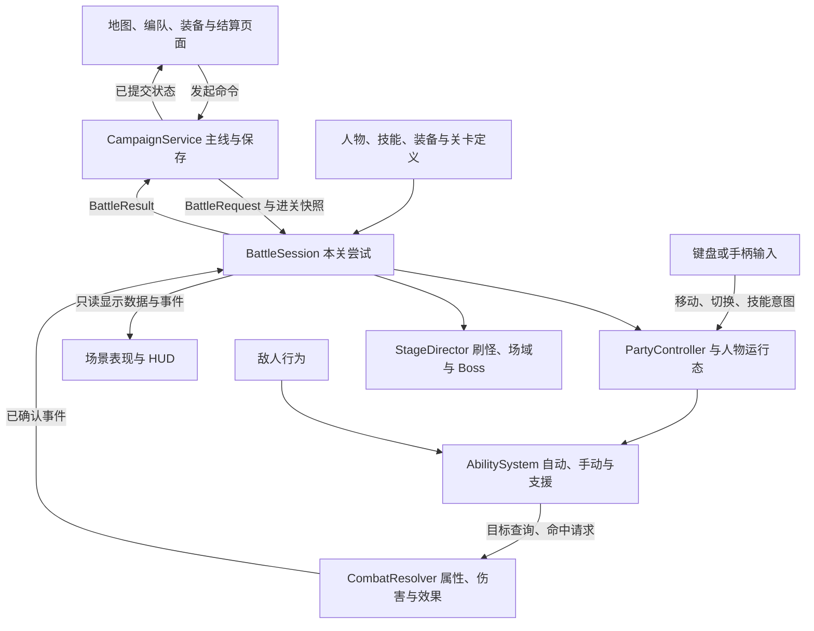

# 真实战斗、操作逻辑与可扩展架构

依据：[设计共识](../00_当前设计共识.md)、[战斗规则](../03_战斗系统与角色机制.md)、[当前实现状态](../08_当前实现状态与后续重点.md)。这是本轮源码核对与外部调研形成的**工程提案**，没有实现新战斗，也没有把未确认的技能、数值或操作细节改写为用户决定。

后续实施：用户授权开始解决后，已完成[前两关真实战斗接入](../implementation/2026-10-27_前两关真实战斗接入.md)。本页保留提案时的调查与取舍；运行范围、采用的初值及尚未实现部分以该实施记录和当前状态为准。

## 结论与参考范围

已有可参考的移动、自动索敌、技能运行态和状态机实现。在本次核对的项目中，未找到直接覆盖“固定主角＋两辅助、后台支援、无限候补、跨关独立资源、失败回退、剧情开池”的完整框架。建议沿用 Godot 4.6.2，采用场景组合、共享内容定义、独立人物运行态和少量显式状态机；先贯通连续两关，再按真实内容需要扩展。

### 已核对的一手资料

| 来源 | 可以参考什么 | 本作如何采用 |
| --- | --- | --- |
| [GDQuest 幸存者教程与源码](https://github.com/gdquest-demos/getting-started-with-godot-4/tree/main/2d-project-completed) | 移动、范围内自动瞄准、定时射击、追踪敌人与刷怪的最小闭环。实际 `gun.gd` 选择重叠列表首个敌人。 | 用于核对基础闭环；本作另做稳定的目标选择和独立角色状态，不直接套教程的索敌优先级。代码为 MIT，美术另为 CC BY-NC-SA，不能把示例素材一并当成自由商用资源，见其 [LICENSE](https://github.com/gdquest-demos/getting-started-with-godot-4/blob/main/LICENSE)。 |
| [OctoD Gameplay Abilities](https://github.com/OctoD/godot-gameplay-abilities) | `Ability` 定义、`AbilityContainer` 容器、`RuntimeAbility` 个人运行实例的分工，以及激活、取消和冷却生命周期。 | 借鉴分层。其[旧框架](https://github.com/OctoD/godot-gameplay-systems)明确提示正在向 GDExtension 重写并改变 API；新版本涉及原生扩展构建。首版先用项目内 GDScript 小实现，不立即增加二进制依赖。新库 MIT，尚未在本仓库验证兼容性。 |
| [Godot State Charts](https://derkork.github.io/godot-statecharts/usage) | 复合状态、并行状态、转移与事件顺序；有冷却、保存和性能示例。 | 可作为复杂 Boss 的备选。首关刷怪／Boss／结束以及普通敌人用小型显式状态机即可；不为每个小兵和弹体安装完整状态图。项目 [MIT 许可](https://github.com/derkork/godot-statecharts/blob/main/LICENSE)。 |
| [Epic Gameplay Ability System](https://dev.epicgames.com/documentation/en-us/unreal-engine/gameplay-ability-system-for-unreal-engine) | 能力、属性、效果分离，主动与被动效果共用基础机制。 | 只借鉴概念；不迁移 Unreal 运行框架，也不为当前单机需求提前建立网络预测体系。 |

上述“如何采用”是结合本项目作出的判断，不是来源对本作的推荐。本轮未安装插件、复制外部代码或运行这些示例，许可也不等于已通过 Godot 4.6.2 接入验证。

Godot 官方文档支持以 [Resource 承载内容数据](https://docs.godotengine.org/en/4.6/tutorials/scripting/resources.html)，由[场景上层注入依赖、通过方法发起行为、用信号报告结果](https://docs.godotengine.org/en/4.6/tutorials/best_practices/scene_organization.html)。资源会被共享加载，因此“定义资源只读、实例状态单独保存”尤其重要；Resource 本身并不自动不可变。

## 当前代码为什么需要改变边界

本轮先查询既有 Graphify 图谱定位，再读当前源码核对。图谱已标过期，不能证明当前调用关系。下列文件属于当前工作树中的旧版运行链，并非 `archive/legacy/` 的历史副本。

| 当前入口 | 核对到的事实 | 新实现的处理 |
| --- | --- | --- |
| [`player.gd`](../../scripts/player.gd)、[`player_survival_flow.gd`](../../scripts/player/player_survival_flow.gd) | 主对象持有大量角色、成长和战斗状态；外拆静态流程仍通过 `owner` 改写主对象。输入、移动、回能、拾取和受伤仍相互连接。 | 分离人物状态、场上身体、输入和成长；不能仅把大文件继续拆成读取同一 `owner` 的小文件。 |
| [`player_damage_resolver.gd`](../../scripts/player/player_damage_resolver.gd) | 统一伤害入口直接依赖多名角色的天赋及专属实现。 | 保留统一结算思想，移出具体角色分支。角色通过声明效果或专用能力处理器接入。 |
| [`player_targeting.gd`](../../scripts/player/player_targeting.gd)、[`player_survival_flow.gd`](../../scripts/player/player_survival_flow.gd) | 有最近、远端、Boss 与聚类查询，也有直接读取鼠标的落点和方向路径。 | 复用空间查询算法，重写目标策略入口；正式战斗不把鼠标作为必需输入。 |
| [`player_switch_flow.gd`](../../scripts/player/player_switch_flow.gd) | 混有切换增益、退场／入场逻辑和角色分支，部分入口已被常量关闭。 | 新切换只处理合法对象、公共冷却、前后台能力权限和外观交接；特殊登场技由对应角色声明。不能根据保留的常量误称所有旧效果都在生效。 |
| [`player_damage_job_queue.gd`](../../scripts/player/player_damage_job_queue.gd) | 实际伤害受每个渲染帧的数量与耗时预算约束；队列还直接依赖旧天赋。 | 复用批处理、身份检查经验；重新建立逻辑顺序。表现可延后，胜负和伤害不能任由渲染预算改变先后。这里是新架构风险，不宣称已经复现某个新关卡结算错误。 |
| [`enemy_spatial_grid.gd`](../../scripts/enemies/enemy_spatial_grid.gd)、[`enemy_pool_lifecycle.gd`](../../scripts/enemies/enemy_pool_lifecycle.gd) | 已有网格查询、缓存、池回收与状态清理，部分依赖当前场景和特定敌人字段。 | 优先评估算法与生命周期保护；改为明确传入本战斗对象，不能原封不动当成无依赖库。 |
| [`chronicle_session.gd`](../../scripts/ui/chronicle/chronicle_session.gd)、[`chronicle_battle.gd`](../../scripts/ui/chronicle/chronicle_battle.gd) | 已有战斗请求／结果接缝，但血魔、技能、奖励及保存仍是 UI 演练模型。 | 保留页面与交互成果，接正式服务；不在演练脚本里逐渐塞进整套真实战斗。 |

旧版敌人资源、碰撞查询、音效、攻击表现和对象池是复用候选。旧技能点、天赋选卡、切换能量、20波推进及旧奖励链不成为新系统兼容要求。复用以“提取后不再反向拉入旧成长链”为条件。

## 操作逻辑：少量输入仍须有稳定反馈

以下是首版建议，具体键位、时长和手感参数仍为提案：

- 沿用新 HUD 的 WASD／方向键移动、Q／E 在本关存活人物间前后切换、J／K 调用当前人物的两个关键技能、Esc 暂停。切换跳过空位和阵亡者；只有一人时按切换不消耗公共冷却。全部通过 InputMap 动作接入，避免散落物理键判断。
- 普攻、常规技能与后台支援由各自节奏触发，不扣手动技能的魔法。基本近战以可边走边打为起点；手动重击可有清晰的短前摇，不让频繁自动攻击持续锁住移动。
- 自动索敌先过滤存活、有效范围和可命中目标，再按能力策略选择。近战优先近身威胁，远程优先当前稳定目标，范围技可选密集区域；不统一设为永远追 Boss，也不每帧因微小距离变化转头。
- 当前目标仍有效时给予短暂保留；目标失效再重新选择。一个攻击在关键时点锁定目标或方向，默认不在已挥出后突然转向。范围技落点与投射物朝向都由同一目标查询接口提供。
- 手动技能可接受一个很短的输入缓冲，减少“冷却差一点结束而按键被吃”的感受。缓冲绑定发出时的人物和技能，切人不把旧输入转交给新人物。无目标是否可释放按技能定义，失败不扣魔法、不启动冷却，HUD 给出简短原因。
- 同一逻辑拍同时收到切换与新技能输入，建议先确定切换，再将新技能指令绑定切换后的当前人物；这与上一条的旧缓冲区分。辅助阵亡的强制回主角不受公共切换冷却阻挡。

战斗的判断来自站位、选场域、避开预警、技能时机和是否切人。先用近战追击、远程压制和一个有明确前摇的 Boss 验证这些判断；不靠增加操作键或强制轮转制造复杂度。自动瞄准需要可辨认的朝向、攻击轨迹与当前目标反馈，不能要求玩家从后台公式猜技能打谁。

## 建议架构：每类状态有一个明确的写入者

这里的模块首先是责任边界，不要求立刻生成相同数量的目录、抽象基类或空接口。

### 三种数据不能混放

| 数据 | 建议载体与归属 | 生命周期 |
| --- | --- | --- |
| 内容定义 | 带类型的 `Resource`：人物成长、能力列表、攻击形态、效果、敌人和关卡配置。内容仓库提供 ID 查询。 | 共享、按约定只读；不放当前 HP、冷却或攻击目标。 |
| 人物与主线存档 | `CampaignState`／`CharacterRecord`，由 `CampaignService` 修改并保存。人物 ID、等级、经验、HP、MP、阵亡、按技能 ID 保存的冷却，以及路线／开池／装备等。 | 跨关；明确序列化与版本，不保存场景 Node 引用。 |
| 本关运行状态 | `BattleSession` 持有本次尝试的工作副本；`CharacterRuntime`、技能实例、敌人、效果和关卡进度。由各职责模块写其负责字段。 | 关内；成功提交合法成果，失败整体丢弃。 |

现有路线、人物目录等 JSON 可继续作编辑输入，但应在加载边界校验并转为明确类型。技能行为采用 `.tres` 参数与脚本组合；不要同时维护两套同名数值来源，也不把复杂战斗写成一门巨大的 JSON 脚本语言。

人物需要稳定 ID。冷却按技能 ID 保存，不能只存“第一个槽还有几秒”；以后升级替换技能或切换武器时，旧技能状态不能因槽位变化被意外清空。UI 只拿快照或经过保护的显示数据，不获得可随手改写的战斗字典。

### 人物状态与场上身体分离

本关最多三个独立人物运行对象，分别保存血量、魔法、冷却和效果。场景通常只有一个可操控、可被普通攻击命中的身体；切换时让它绑定另一位人物的运行态、外观和攻击配置，并保留位置。后台辅助通过支援发射点、法阵或召唤表现参与，不需要常驻两个会寻路和挡路的友军身体。

这是运行实现的分工，不改变“主角与独立伙伴”的人物设定。以后某个辅助需要实体分身或代伤，也由该能力显式创建自己的接收伤害对象。

| 所处范围 | 状态与权限 |
| --- | --- |
| 当前操作人物 | 移动、直接受击、自动普攻／常规技能、两个手动槽；推进自身回魔和冷却。 |
| 本关后台存活辅助 | 推进回魔、冷却和应持续的临时效果；按后台能力触发支援，不注册普通受击目标。 |
| 未配置候补 | 不加入战斗时钟；HP／MP／冷却不自然变化。持有数值加成仍由人物记录推导。 |
| 本关阵亡辅助 | 停止能力与支援，记录阵亡；经验分配仍保留其份额，升级不复活。阵亡后冷却是否继续仅作为待实现的统一策略，不允许由各 UI 自行决定。 |

主角切到后台后仍有独立状态，不能视为角色消失。主角是否有后台支援仍待角色设计，默认不凭空赠送。持有加成、配置辅助产生的效果、仅后台生效的效果分别带作用范围；“有这张卡就能驱散／复活”在定义校验层即应被拒绝。

### 技能统一施放，特殊机制保留代码空间

输入控制器、普攻节奏、自动常规技能、后台支援和敌人 AI 都提交能力激活请求。能力系统统一检查：来源是否合法且存活、当前作用范围、等级解锁、目标、冷却、魔法和控制状态。通过后创建一次施放实例，处理前摇、实际效果、结束及取消。

每个技能有共享定义与每人物独有的运行实例。前者描述目标策略、耗魔、冷却、施放阶段及效果；后者保存剩余冷却、正在进行的施放和本次目标。普通攻击同样经过这条链，只是不耗魔且由自动控制器发起。

常见效果先支持伤害、治疗、属性修正、状态施加、投射物和范围命中。驱散、召唤、代伤等在首个真实使用者出现时扩充。特色角色可以有专用能力脚本；它调用战斗服务，不能直接操作主线存档或让通用伤害模块 `match character_id`。

例如艾玛释放火球后切回贾苇索：火球保留艾玛的来源、施放时攻击参数和附魔资格；不会到命中时改读贾苇索的攻击力。艾玛的冷却与回魔继续推进，后台能力按配置恢复工作。火球是否受自身后续增益影响、召唤物是否动态继承属性，在对应能力中声明，默认采用施放时来源快照。

### 统一伤害与效果，来源可追溯

每次命中至少携带：本关尝试 ID、来源人物／实体、技能 ID、施放 ID、目标实体及激活代数、伤害种类、直接／支援／召唤等来源类别，以及效果触发链标识。

建议顺序为：检查目标和命中去重 → 明确代伤或拦截 → 计算实际承伤者的防御、护盾和受击效果 → 扣资源 → 确认死亡 → 记录伤害与死亡事件 → 派生有边界的后续效果。代伤不能对同一份伤害重复计算两个人的护甲；细节随首个代伤角色确定。

饰品附魔依据攻击发出时的来源范围判断；切人不能让已经发出的前台攻击忽然失去附魔或把后台攻击变成前台攻击。护甲效果绑定实际承伤者。反伤、连锁雷电和击杀爆炸有统一触发限制，避免彼此无限递归；不通过在多个角色脚本里各加一个布尔标记补漏洞。

属性计算明确基础值、固定加成、同类百分比相加及特殊乘区的顺序；具体公式和上限仍待数值验证。持有加成在入关、相关等级变化等事件后重算或失效重建，不每帧遍历全部人物。由本关升级引起的变化只作用于尝试副本，失败不得漏回主线。调试视图能解释“数值来自哪张卡、装备或状态”，不向玩家界面暴露内部实现术语。

玩家与敌人共用命中、伤害及状态协议，敌人不因此被迫拥有编队、人物卡和跨关成长系统。普通敌人可共享移动／攻击行为，精英由配置与少量能力组合，Boss 使用独立的有限阶段与招式状态机。

### 战斗时钟、胜负与保存是一条有顺序的链

`BattleSession` 负责装配和推进，各模块各管状态；它不承担每个技能的具体算法。Godot 的[物理处理与渲染处理](https://docs.godotengine.org/en/4.6/tutorials/scripting/idle_and_physics_processing.html)分开：移动、能力、命中、冷却与关卡判定采用统一逻辑时序，画面插值和装饰性动画可按渲染帧刷新。

建议每个逻辑拍按固定阶段处理输入、计时与移动、能力和碰撞、伤害及死亡、经验与关卡转移，再发布显示事件。物理回调先收集命中请求，按明确顺序结算；不能让信号连接顺序决定胜负。共享场上身体切换前后，已收集命中必须绑定当时的目标人物，防止延后结算转移给错误的人。

Boss 出场条件为计时或击杀数满足任一且尚未出场，由 `StageDirector` 唯一触发；出场停止普通刷怪。四角选择同样由它一次性确认并关闭其余三处。Boss 和专属援军的经验预算与掉落来源明确，死亡事件只登记一次。

Boss 死亡后不再推进下一拍战斗，也不开放继续清理精英的阶段；当前已发生的命中批次须结算到一致点。**提案：同一批次主角与 Boss 同归于尽按失败；同一批次已击杀的额外精英计奖励。** 这两个边界尚非用户确认规则，应在实现时成为明确测试，而非取决于回调偶然顺序。死亡已确认的人物不会被通关收取经验后的升级回满救活。

实际伤害可以批量计算，但不能为省渲染预算随意丢弃或延迟到任意后续帧；先控制刷怪／特效规模、缩小空间查询、合并语义等价的计算。飘字、次要火花与音效叠加可以限流。保留对象池激活代数，旧弹体或延迟事件不能命中新一轮复用的实体。跨场景清空查询缓存和订阅。

暂停原因采用集中所有权，保留旧工程已验证的思路。关间菜单与暂停不推进本关计时；候补从不注册进时钟。固定更新顺序与独立随机流帮助复现问题，但不声称 Godot 物理由一个种子就能跨机器完全确定重放。

正式保存流程建议如下：

1. 出战生成 `BattleRequest` 和进关快照。本关成员列表固定，并作为经验分配的分母；请求带关卡定义版本、装备、人物状态、持有加成来源及随机状态。
2. 战斗中经验、升级回满、拾取装备和阵亡只改尝试副本。失败或战斗未结束时退出，丢弃尝试，回到该快照。
3. 胜利输出一次 `BattleResult`：人物最终资源／经验、实际击杀和场域成果。主线服务验证它属于当前尝试，再生成并持久化待结算状态。剧情开池先后及首关艾玛加入由主线事件规则处理，不由 Boss 脚本操作卡池。
4. 待结算保存实际候选、已选项与领取状态；重新打开不重抽。正式确认选卡后，同一提交中完成新卡／重复升级、推进节点和保存，重复调用不能重复获益。存盘失败保留可重试状态，不假装已经领取。
5. 旧档整体回退，不与新进度合并。战斗、掉落、卡池随机源分开；失败重试哪些内容重新随机仍是玩法待定项，不能在架构阶段默认全部固定或全部重掷。

正式数据必须使用自己的版本和命名空间；旧版运行档、`chronicle_ui_v1` 演练档和正式主线档不互相覆盖。UI 通过一个明确适配器接正式服务，保留 `battle_requested`／结果回传这类边界，不让战斗反过来调用页面节点。

## 如何保证后续修改局部发生

| 要做的改动 | 正常应修改的位置 | 不应牵动的位置 |
| --- | --- | --- |
| 增加一个普通辅助 | 人物定义、前台／支援／持有配置、成长与剧情入池条件 | 输入、切人、保存格式和通用伤害算法 |
| 增加一种特殊角色机制 | 对应能力处理器和必要的通用效果操作，并配一个行为测试 | 全角色 `match` 分支或到处追加专属字段 |
| 新增主角长枪武器 | 武器攻击形态：范围、节奏、目标策略与表现 | 艾玛的攻击、辅助独立资源、主线流程 |
| 新增附魔或护甲 | 装备效果与触发范围 | 每个技能手写一次同类附魔、全局改写实际承伤对象 |
| 调整 Boss 提前出现 | 关卡定义的计时／击杀阈值 | HUD 计时、人物脚本和奖励页 |
| 修改按键或加入手柄 | 输入映射与意图转换 | 能力规则、伤害公式和存档 |

可扩展性的验收是这些改动能否局部完成，而不是脚本数量。先采用直接、带类型的方法调用完成行为；信号报告已发生事件给 HUD、音频与局部订阅者。避免一个全局事件总线让所有模块互相修改状态，也不提前引入完整 ECS、服务定位器、万能技能编辑器或插件集合。

建议新增 `scripts/battle/` 放新战斗责任边界、`scripts/campaign/` 放正式主线事务，配合内容定义与已有 UI。旧 `scripts/combat/` 中的纯规则按需引用或提取。路径只是组织建议，首批实现不预建未来几十个空模块。

## 分三步形成第一个可玩成果

1. **真实单人首战。** 贾苇索的移动、自动近战、一个手动关键技能、两种基础敌人和一个简化 Boss；完成目标查询、受击、死亡、Boss 两种触发条件、真实 HUD 和胜负出口。用简化素材也必须能实际玩，先检查移动、索敌、攻击节奏与预警。
2. **独立人物与支援。** 接入艾玛和一个基础辅助以覆盖两个辅助位；三份资源、切换、自动后台帮助、辅助死亡强制回主角、候补冻结与实际人数分经验。首关仍单人，艾玛战后加入，第二关才能配置。测试用人物组合不擅自扩大正式初始卡池。
3. **连续两关的正式闭环。** 接四角场域与额外精英、两种武器形态和基础饰品／护甲、升级解锁、五选二／额外五选三、关间换人与装备、泉水、失败回退和待结算续玩。章末七选三／七选四规则复用结算服务，通过独立场景验证，不必先制作完整章末剧情。

通过这个成果后再扩大白门楼内容。此时应能用新增一个人物配置和一个能力脚本的方法加入下一名角色，才说明架构经受了扩展，而不仅是目录整齐。

### 首批需要的验证

- 规则测试：单人／两人／三人经验与阵亡份额；独立 HP／MP／冷却；候补冻结；升级不复活；前台命中与后台支援权限；武器和附魔作用对象。
- 生命周期测试：空位切换、公共冷却与强制退场；切人不刷新技能；发射后切人来源不变；池对象复用不误命中；效果触发不无限循环；Boss 门槛、四角选择和胜负只触发一次。
- 保存集成测试：失败回退全部本关收益；胜利结果与选卡各提交一次；候选和选择续存；故障写入能重试；旧档、演练档与正式档隔离。
- 实玩与性能：只用键盘完成连续两关；检查近战黏滞、索敌抖动、技能空放和预警可读性。按定义好的敌人／弹体／效果密度记录物理耗时和高分位帧耗时，当前尚无新战斗性能结果。自动测试不能替代这些体验判断。

切换如何取消未出手技能、耗魔的提交时点、后台持续伤害、召唤者死亡后的召唤物、阵亡人物冷却及同批次胜负优先级，需要在首个涉及它们的能力落地时明确默认值和测试。本提案已指出接口位置，不提前为所有可能例外建立框架，也不把这些问题重新变成开工前的大问卷。
